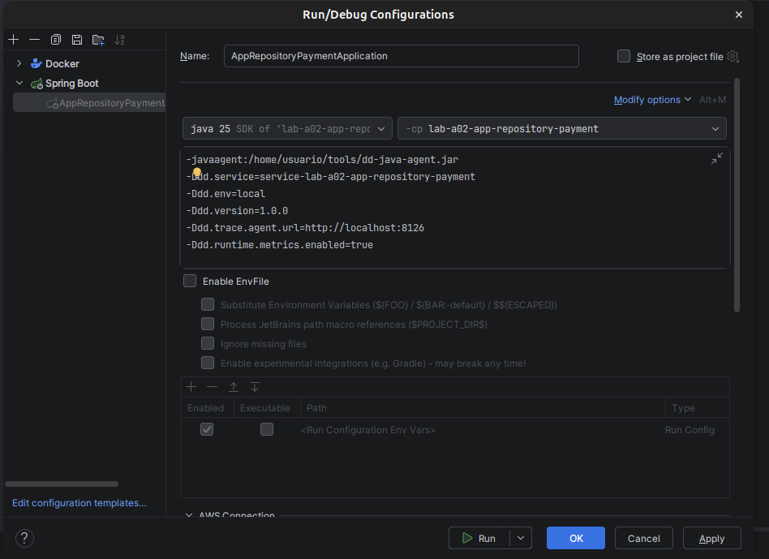
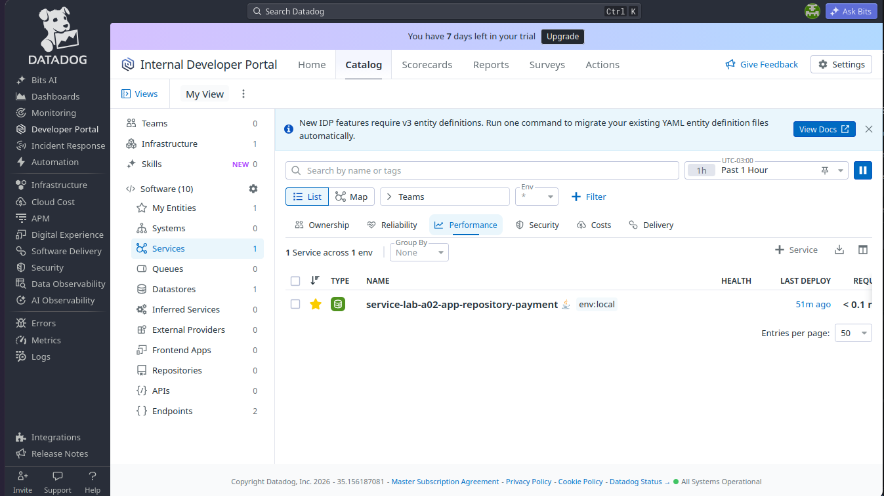
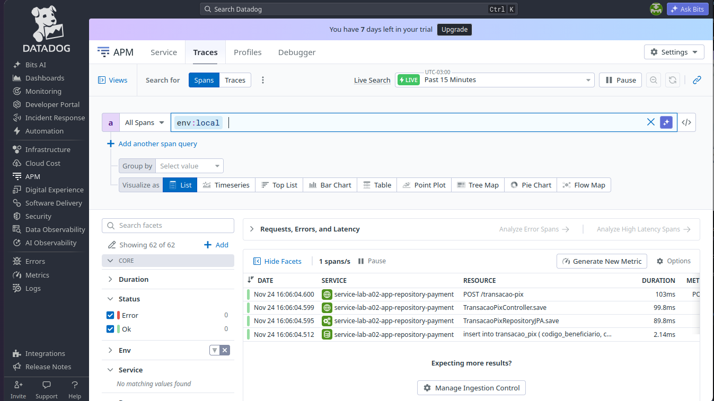
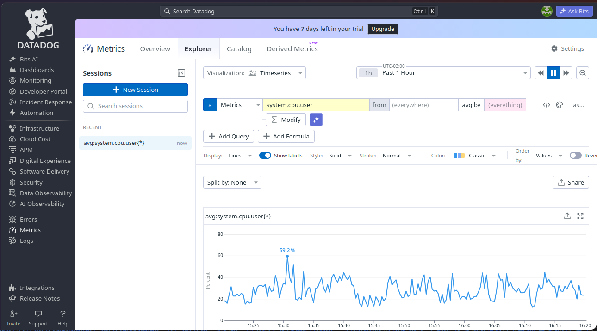
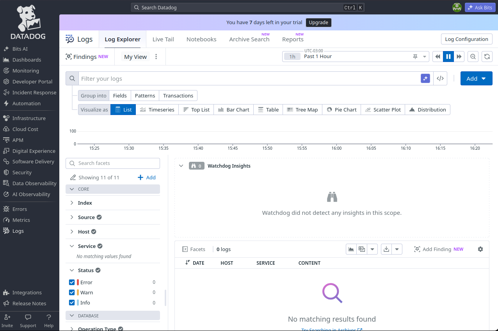

# 📊 Datadog local para aplicações Spring Boot

Este projeto executa o **Datadog Agent em um container Docker**, enquanto a aplicação **Spring Boot continua sendo iniciada diretamente pelo IntelliJ IDEA**. O Agent recebe traces APM da aplicação, métricas de runtime via DogStatsD e coleta logs e métricas dos containers Docker.

A configuração pode ser reutilizada por diferentes aplicações Java. Os mounts de `/proc` e `/sys/fs/cgroup` são voltados a hosts Linux; no Windows com Docker Desktop, a coleta de métricas do host pode exigir adaptações.

> **Importante:** o Agent roda localmente, mas encaminha traces, métricas e logs para a sua conta Datadog na nuvem. Esses dados não ficam exclusivamente na máquina local.

## 1. 🏗️ Arquitetura

```text
IntelliJ IDEA
└── Aplicação Spring Boot (executada na máquina)
    └── dd-java-agent.jar
        └── HTTP localhost:8126
            └── Docker: Datadog Agent
                └── Datadog Cloud
                    └── APM / Metrics Explorer / Dashboards
```

Componentes:

- **Datadog Agent:** serviço em container que recebe traces, métricas e logs e os encaminha ao Datadog.
- **Java Tracer (`dd-java-agent.jar`):** biblioteca de instrumentação carregada pela JVM com `-javaagent`.
- **Datadog Cloud:** interface na qual os dados enviados podem ser consultados.

O Java Tracer e o Datadog Agent são componentes diferentes. Para este fluxo de APM, ambos são utilizados.

## 2. ✅ Pré-requisitos

- Docker Engine e Docker Compose v2 no Linux; ou Docker Desktop no Windows.
- IntelliJ IDEA.
- JDK compatível com a aplicação.
- Conta Datadog.
- API Key do Datadog.
- Arquivo `dd-java-agent.jar` baixado da documentação oficial.

Documentação:
- [Instalar o Datadog Agent](https://docs.datadoghq.com/agent/)
- [Java APM / Java Tracer](https://docs.datadoghq.com/tracing/trace_collection/dd_libraries/java/)
- [Docker Compose e Datadog Agent](https://docs.datadoghq.com/containers/guide/compose-and-the-datadog-agent/)

## 3. 📁 Estrutura de arquivos

Crie uma pasta para a infraestrutura local, separada do código da aplicação:

```text
datadog-local/
├── docker-compose.yml
├── .env
└── .gitignore
```

### 🐳 `docker-compose.yml`

```yaml
services:
  datadog-agent:
    image: gcr.io/datadoghq/agent:7
    container_name: dd-agent
    restart: always
    environment:
      DD_API_KEY: ${DD_API_KEY:?Defina DD_API_KEY no arquivo .env}
      DD_SITE: ${DD_SITE:-datadoghq.com}
      DD_HOSTNAME: ${DD_HOSTNAME:-}
      DD_APM_ENABLED: "true"
      DD_APM_NON_LOCAL_TRAFFIC: "true"
      DD_LOGS_ENABLED: "true"
      DD_LOGS_CONFIG_CONTAINER_COLLECT_ALL: "true"
      DD_DOGSTATSD_NON_LOCAL_TRAFFIC: "true"
      DD_CONTAINER_EXCLUDE: "image:gcr.io/datadoghq/agent*"
      DD_CONTAINER_EXCLUDE_METRICS: "image:gcr.io/datadoghq/agent*"
      DD_CONTAINER_EXCLUDE_LOGS: "image:gcr.io/datadoghq/agent*"
    ports:
      - "127.0.0.1:8126:8126/tcp"
      - "127.0.0.1:8125:8125/udp"
    volumes:
      - /var/run/docker.sock:/var/run/docker.sock:ro
      - /proc/:/host/proc/:ro
      - /sys/fs/cgroup/:/host/sys/fs/cgroup:ro
```

O que essa configuração faz:

| Configuração | Finalidade |
|---|---|
| `image` | Utiliza a imagem oficial do Datadog Agent versão 7. |
| `DD_API_KEY` | Autentica o Agent na conta Datadog. |
| `DD_SITE` | Define o site/endpoint Datadog da conta. Use o valor correspondente à sua região. |
| `DD_HOSTNAME` | Nome opcional do host exibido no Datadog; se omitido, o Agent tenta detectá-lo. |
| `DD_APM_ENABLED` | Habilita o recebimento de traces APM. |
| `DD_APM_NON_LOCAL_TRAFFIC` | Permite que o Agent aceite conexões APM vindas de fora do próprio container. |
| `DD_LOGS_ENABLED` | Habilita a coleta de logs. |
| `DD_LOGS_CONFIG_CONTAINER_COLLECT_ALL` | Solicita a coleta de logs de todos os containers, exceto os excluídos. |
| `DD_DOGSTATSD_NON_LOCAL_TRAFFIC` | Permite receber métricas DogStatsD de outros processos/containers. |
| `DD_CONTAINER_EXCLUDE*` | Exclui o próprio Agent da coleta geral, de métricas e de logs. |
| `8126/tcp` | Porta APM publicada somente em `localhost`, para a aplicação no host enviar traces. |
| `8125/udp` | Porta DogStatsD publicada somente em `localhost`, para métricas de runtime da JVM. |
| `restart` | Usa a política `always`: reinicia o container após falhas e quando o daemon Docker inicia. |

Os mounts dão ao Agent acesso ao socket Docker e a dados do host/container:

| Mount | Finalidade |
|---|---|
| `/var/run/docker.sock` | Descobrir containers e coletar seus logs. |
| `/proc` | Consultar informações de processos do host. |
| `/sys/fs/cgroup` | Consultar informações de recursos e limites dos containers. |

Todos estão montados como somente leitura (`:ro`). **Atenção:** o socket Docker ainda permite acesso poderoso à API do daemon; `:ro` não restringe as operações feitas pela API. Use essa configuração apenas em um ambiente confiável.

### 🔐 `.env`

Crie e edite o arquivo `.env` na mesma pasta do Compose:

```dotenv
DD_API_KEY=
DD_SITE=datadoghq.com
# Opcional:
# DD_HOSTNAME=nome-do-host-local
```

Preencha `DD_API_KEY` com a API Key da sua organização. O valor de `DD_SITE` deve corresponder ao site da sua conta Datadog (por exemplo, `datadoghq.com` ou `datadoghq.eu`). Se quiser, informe `DD_HOSTNAME` com um nome estável para identificar a máquina.

**Segurança:** não coloque a API Key no `docker-compose.yml`, não a compartilhe e não faça commit do `.env`.

### 🚫 `.gitignore`

```gitignore
.env
```

## 4. ▶️ Iniciar e administrar o Agent

Execute os comandos a partir da pasta `datadog-local`.

Subir em segundo plano:

```bash
docker compose up -d
```

Verificar o container:

```bash
docker compose ps
```

Acompanhar os logs:

```bash
docker compose logs -f datadog-agent
```

Consultar o status do Agent:

```bash
docker compose exec datadog-agent agent status
```

Parar e remover o container:

```bash
docker compose down
```

Os comandos `docker compose` são os mesmos no Linux e no terminal do Windows com Docker Desktop. Os mounts de `/proc` e `/sys/fs/cgroup` são destinados a Linux; no Docker Desktop, a coleta de métricas do host pode não funcionar da mesma forma.

## 5. ☕ Baixar e configurar o Java Tracer

Baixe o `dd-java-agent.jar` na documentação oficial:

[Datadog Java APM – configuração e instalação](https://docs.datadoghq.com/tracing/trace_collection/dd_libraries/java/)

Salve o arquivo em um diretório conhecido. Por exemplo:

Linux:

```text
/home/usuario/tools/dd-java-agent.jar
```

Windows:

```text
C:\tools\dd-java-agent.jar
```

O caminho é apenas ilustrativo; use o local em que você salvou o arquivo.

## 6. ⚙️ Configurar a aplicação no IntelliJ IDEA

1. Abra **Run → Edit Configurations**.
2. Selecione a configuração de execução da aplicação Spring Boot.
3. Localize **VM options**.
4. Adicione os parâmetros abaixo, ajustando o caminho do JAR.


Exemplo para Linux:

```bash
-javaagent:/home/usuario/tools/dd-java-agent.jar
-Ddd.service=minha-aplicacao
-Ddd.env=local
-Ddd.version=1.0.0
-Ddd.trace.agent.url=http://localhost:8126
-Ddd.runtime.metrics.enabled=true
-Ddd.logs.injection=true
```

Exemplo para Windows:

```text
-javaagent:C:\tools\dd-java-agent.jar
-Ddd.service=minha-aplicacao
-Ddd.env=local
-Ddd.version=1.0.0
-Ddd.trace.agent.url=http://localhost:8126
-Ddd.runtime.metrics.enabled=true
-Ddd.logs.injection=true
```

### 🌱 Alternativa com variáveis de ambiente

Também é possível configurar os mesmos valores em **Run → Edit Configurations → Environment variables**. Adicione cada variável à configuração de execução:

```dotenv
JAVA_TOOL_OPTIONS=-javaagent:/home/usuario/tools/dd-java-agent.jar
DD_SERVICE=minha-aplicacao
DD_ENV=local
DD_VERSION=1.0.0
DD_TRACE_AGENT_URL=http://localhost:8126
DD_RUNTIME_METRICS_ENABLED=true
DD_LOGS_INJECTION=true
```

No Windows, ajuste o valor de `JAVA_TOOL_OPTIONS`, por exemplo: `-javaagent:C:\tools\dd-java-agent.jar`.

`JAVA_TOOL_OPTIONS` faz a JVM carregar o tracer; as demais variáveis configuram serviço, ambiente, versão e endereço do Agent. Configure-as na execução da aplicação no IntelliJ, em vez de defini-las globalmente no sistema, para não afetar outros processos Java.

Significado dos parâmetros:

| Parâmetro | Finalidade |
|---|---|
| `-javaagent` | Carrega o Datadog Java Tracer na JVM. |
| `dd.service` | Nome lógico do serviço que aparecerá no APM. |
| `dd.env` | Identifica o ambiente como `local`. |
| `dd.version` | Identifica a versão da aplicação. |
| `dd.trace.agent.url` | Endereço do Agent que recebe os traces. |
| `dd.runtime.metrics.enabled` / `DD_RUNTIME_METRICS_ENABLED` | Habilita métricas de runtime da JVM. |
| `dd.logs.injection` / `DD_LOGS_INJECTION` | Injeta IDs de trace e span no contexto dos logs para correlacioná-los com traces. |

O endereço `localhost:8126` funciona porque a aplicação roda na máquina host e a porta do container foi publicada no host.

Para enviar métricas de runtime da JVM, habilite a configuração descrita na próxima seção. A porta UDP `8125` também é publicada em `localhost` para essa finalidade.

A injeção de logs adiciona contexto de trace/span aos logs, mas não habilita a coleta nem o envio deles. O framework e o formato de logging da aplicação também precisam incluir esse contexto na saída.

Depois, salve a configuração e inicie a aplicação pelo IntelliJ.

## 7. 📈 Métricas de runtime da JVM

Para habilitar métricas de runtime, configure a variável de ambiente:

```text
DD_RUNTIME_METRICS_ENABLED=true
```

No IntelliJ, isso pode ser feito em **Run → Edit Configurations → Environment variables**.

Também é possível usar a propriedade Java equivalente nas VM options:

```bash
-Ddd.runtime.metrics.enabled=true
```

Use uma das formas e confira a configuração efetiva na documentação da versão do Java Tracer utilizada.

As métricas de runtime podem incluir informações como:

- Heap e Non-Heap.
- Garbage Collection.
- Threads.
- Classes carregadas.

A disponibilidade e os nomes das métricas dependem da versão do tracer e da configuração.

Documentação: [Java Runtime Metrics](https://docs.datadoghq.com/tracing/metrics/runtime_metrics/?tab=java).

## 8. 🔎 Onde consultar os dados no Datadog

Após iniciar o Agent e executar a aplicação, gere tráfego fazendo chamadas aos endpoints da aplicação.

Na interface Datadog, consulte:

- **APM → Services:** procure pelo serviço definido em `dd.service`.

- **APM → Traces:** visualize os rastreamentos das requisições.

- **Metrics → Explorer:** pesquise métricas de runtime e APM disponíveis para a conta.

- **Logs → Explorer:** consulte os logs coletados dos containers.

Use `env:local` e o nome do serviço para filtrar os dados, quando esses atributos estiverem disponíveis.

A primeira visualização pode levar alguns minutos e depende da chegada de telemetria. Uma aplicação sem requisições pode não produzir traces para exibição.

## 9. 📊 Diferença entre traces, métricas e métricas customizadas

É importante distinguir os tipos de telemetria:

| Tipo | Exemplos | Como obter |
|---|---|---|
| Traces APM | Caminho da requisição, duração, spans e erros | Java Tracer + Agent |
| Métricas de runtime | Heap, GC, threads e classes | Java Tracer com runtime metrics habilitado |
| Métricas customizadas | Contagem de pedidos, regra de negócio, duração de operação específica | Instrumentação da aplicação ou integração apropriada |

O Compose habilita traces APM, coleta logs e métricas dos containers e permite que a JVM envie métricas de runtime quando essa opção é habilitada no tracer. Ele não cria automaticamente métricas de negócio personalizadas.

## 10. 💻 Linux e Windows: observações

O envio de traces e métricas pela aplicação local usa as portas publicadas em `localhost`:

- O Docker publica a porta `8126` na máquina host.
- O Docker publica a porta UDP `8125` para DogStatsD.
- A aplicação iniciada pelo IntelliJ aponta para `http://localhost:8126`.
- O único ajuste habitual nas VM options é o caminho do `dd-java-agent.jar`.

No Windows, utilize Docker Desktop com o backend Linux containers. Os mounts de `/proc`, `/sys/fs/cgroup` e do socket Docker são voltados ao Linux; a coleta de métricas do host e de logs pode exigir ajustes no Docker Desktop.

Se a aplicação estiver dentro de outro container, `localhost` apontará para esse próprio container, e não para o Agent. Nesse caso, a URL do Agent deverá usar o nome de serviço ou endereço de rede apropriado.

## 11. 🛠️ Solução de problemas

### ⚠️ O container não inicia

```bash
docker compose ps
docker compose logs datadog-agent
```

Confira se a API Key e o site Datadog estão corretos.

### 🔌 A aplicação não consegue enviar traces

1. Confirme que o container está em execução.
2. Confirme que a porta `8126` está publicada.
3. Verifique se a URL configurada é `http://localhost:8126`.
4. Verifique os logs da aplicação e do Agent.
5. Confirme que o Java Tracer foi carregado (parâmetro `-javaagent`).

### 🔍 O serviço não aparece no APM

- Gere requisições para a aplicação.
- Confira o valor de `dd.service`.
- Confira se `dd.env=local` foi aplicado.
- Consulte os logs do Agent e aguarde a ingestão dos dados.

## 12. 💰🔒 Observações sobre custo e privacidade

O Agent executa localmente, mas encaminha traces, métricas e logs para a plataforma Datadog. A ingestão pode estar sujeita aos limites e custos do plano contratado. A coleta de logs de todos os containers também pode enviar dados que você não pretendia compartilhar; revise-a antes de iniciar o Agent.

Se a intenção for manter os dados exclusivamente na máquina, sem enviá-los à nuvem Datadog, esta arquitetura não atende a esse requisito. O Datadog Cloud não é substituído pelo container local.

Consulte os detalhes de [APM](https://docs.datadoghq.com/tracing/) e [métricas](https://docs.datadoghq.com/metrics/) na documentação oficial.
